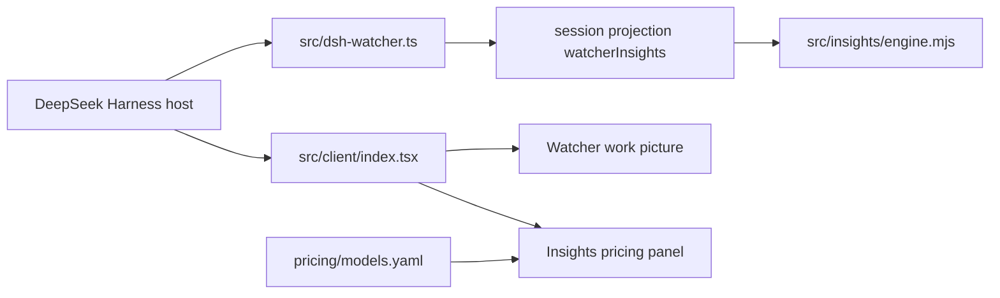

# Watcher architecture

Watcher is one Cordis client plugin. It is not a server, and it does not call an external API.

The host loads `cordis.yml`, which inserts plugin id `dsh-watcher` from `src/dsh-watcher.ts`. `apply` registers session projection `watcherInsights` and awaits the registration (Harness 0.2.2 returns an awaitable handle; 0.2.0 and 0.2.1 return a disposer that `await` passes through). The key stays in Session summaries, which is where Insights reads it from `session.list()`. The projection stores folded token and timing stats. `src/insights/engine.mjs` is the reducer. Zod in `src/insights/projection.ts` checks the state before it is replayed. The projection does not add a transport and does not write model-facing messages.

The client entry `src/client/index.tsx` injects two host slots:

- `settings.section` renders `InsightsSettings` from `src/client/Insights.tsx`.
- `conversation.session.header.utilities` renders the Watcher button, order 50.

The context 水面 prefers the host's token-meter `contextPressure` projection, which only the open session exposes. `src/client/context-reading.ts` picks it, and `watcherInsights.context` (the fold's surface estimate, replacements applied by position) is the fallback. A compressor that rewrites the request outside the Harness session surface writes no `compaction/*` event and no `surfaceOp`, so the fold cannot see that shrinkage. It shows up only in the host indicator. While that indicator is the reading, the composition block shows the Harness surface as percentages, and the per-request "较上一发" delta is not presented as the prompt's real change.

`src/client/Watcher.tsx` reads the host conversation and draws the work picture: turns, steps, parallel tool calls, and the optional model stage. `src/observation/fold.ts` groups those events. A second plugin, dsh-better-sidebar, is optional. `src/client/SidebarTab.tsx` registers a tab only when that service exists. It is not a dependency.

Pricing reads `pricing/models.yaml` and an optional `localStorage` override `dsh-watcher:pricing-override:v1`. Missing prices stay unknown. They are not treated as zero.

`pnpm build` runs `tsc`, then tsdown through the vendored adapter `tools/client-build.js`, and writes `lib/dsh-watcher.js` plus `lib/client.js`. Those two files are what `dsh plugin add` loads. `lib/types/` is only for local tests.
